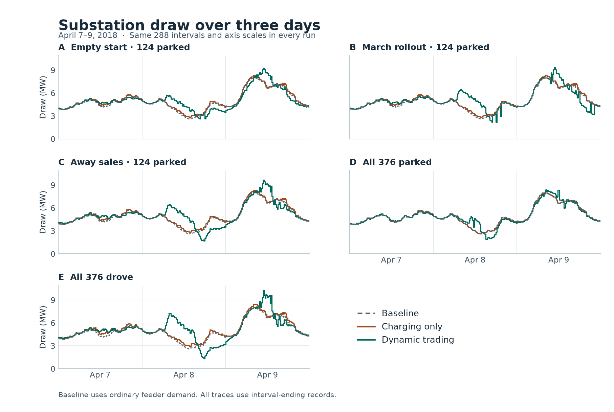
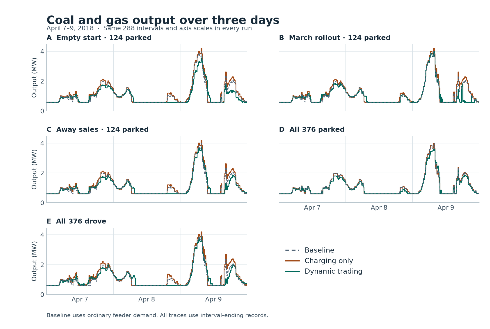
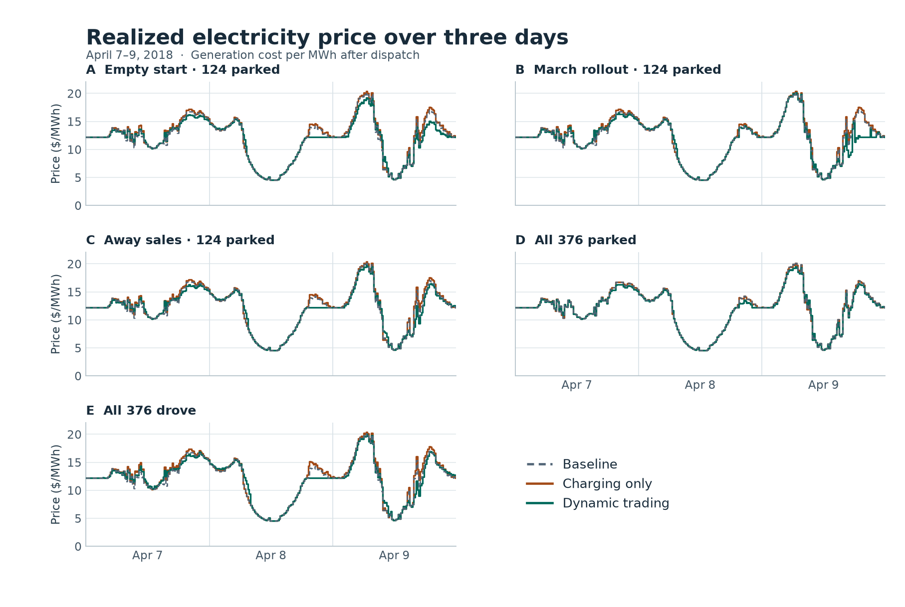
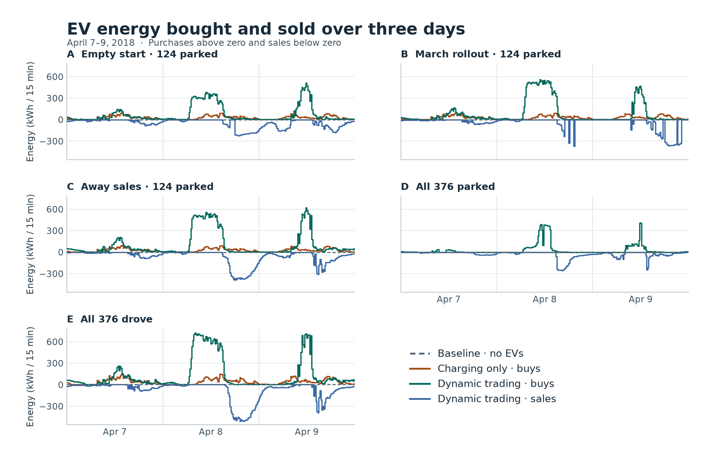
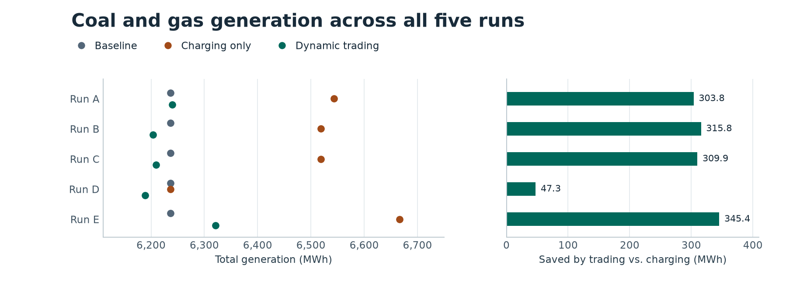

# EV energy trading on a Greensboro distribution feeder

**Model and results from five 150-day simulations | April 1–August 28, 2018**

## Overview

This study asks how much coal and natural gas generation a distribution feeder can avoid when electric vehicles choose **when to charge, when to sell power back, and when to wait**. We tested that question in five 150-day simulations on a synthetic feeder in Greensboro, North Carolina. Each run compared three cases under the same grid and generation assumptions: **no EVs, EV charging only, and dynamic EV trading**.

We built the model in five steps:

1. **Model the grid.** We used the Greensboro SMART-DS network and ran OpenDSS every 15 minutes to track power demand, feeder losses, voltages, and equipment loading.
2. **Build the EV fleet.** We applied Greensboro household vehicle ownership data to 447 eligible homes. This gave 751 vehicles, or 1.68 per household. At 50% EV adoption, we modeled 376 EVs across four battery classes.
3. **Model travel and charging.** We sampled daily trips from the National Household Travel Survey. EVs could charge at home and at equipped destinations. In four runs, a March rollout let batteries accumulate charge and establish the cost of that stored energy before trading began.
4. **Dispatch generation and trade.** Fixed nuclear output and available solar supplied the feeder, with coal and gas adjusting to cover the remaining demand. Every 15 minutes, we shuffled the order of eligible EVs and updated the price after each commitment. Each connected EV could buy, sell, or wait based on the price, the cost of its stored energy, and the charge it needed for upcoming trips.
5. **Compare the runs.** We varied the rollout, the number of EVs that stayed parked, where they could sell power, and whether exports were screened against grid limits. We compared generation, customer bills, trade volumes, and grid violations.

Across all five runs, dynamic trading used less coal and gas than charging alone. The largest reduction was **345.39 MWh, or 5.18%**, in the run where all EVs followed driving schedules. That run still used more coal and gas than the no-EV baseline, and its trading case recorded the most overload and voltage violation intervals of the five runs.

## 1. Build the network and the EV fleet

We used **SMART-DS substation uhs19_1247** in Greensboro, North Carolina. Its synthetic network represents plausible local infrastructure and uses a full year of modeled demand at 15-minute resolution. OpenDSS solves power flow for each interval, including feeder losses, bus voltage, and equipment loading. The model boundary runs from a 69 kV supply to customer connections. [SMART-DS dataset](https://data.openei.org/submissions/2981)

| Network inventory | Count |
|---|---:|
| Feeders / buses | 2 / 2,087 |
| Lines / transformers | 1,755 / 335 |
| Electrical load objects / unique customer connections | 1,329 / 732 |
| Residential-profile / commercial-profile connections | 458 / 274 |
| Residential connections eligible for household fleet assignment | 447 |

The 447 eligible connections are 120/240 V split-phase services, each treated as one household for fleet assignment. The other 11 residential-profile services still draw power. A split-phase service can contain two OpenDSS load objects, which is why the object and customer counts differ. The load files use residential and commercial profiles. They give no separate count of verified industrial customers. In the latest baseline, the feeder drew **23,591 MWh** over 150 days and peaked at **11.83 MW**, including losses.

### From households to 376 EVs

The Greensboro American Community Survey’s 2020–2024 estimates give shares of **8.2%, 40.1%, 34.2%, and 17.5%** for households with **0, 1, 2, and 3+ vehicles**, respectively. We split the final group into **12% with 3 vehicles, 4% with 4, and 1.5% with 5** as a modeling assumption. Applied to the feeder, the six groups contained **37, 179, 153, 53, 18, and 7 households**. Their vehicle counts sum to **751**, giving **751 ÷ 447 = 1.68 vehicles per household**. Fleet seed 32 assigns the ownership counts to homes and selects **376 EVs** at the **50% adoption** setting. [Census ACS housing table](https://data.census.gov/table/ACSDP5Y2024.DP04?g=160XX00US3728000) · [Greensboro ACS figures as tabulated by Neilsberg](https://www.neilsberg.com/insights/topic/greensboro-nc/)

| EV segment | Target share | EVs assigned | Battery | Level 2 charging | Mean driving use |
|---|---:|---:|---:|---:|---:|
| Small | 5% | 17 | 35 kWh | 3.84 kW | 0.15 kWh/km |
| Compact | 20% | 77 | 55 kWh | 7.68 kW | 0.17 kWh/km |
| Long-range / family | 60% | 214 | 77.5 kWh | 9.60 kW | 0.20 kWh/km |
| Large SUV / pickup | 15% | 68 | 110 kWh | 11.52 kW | 0.27 kWh/km |

These battery classes and charger ratings are scenario inputs. The fleet has **28.90 MWh** of nominal storage. All EVs have home chargers, including **59 Level 1 chargers at 1.44 kW** and **317 Level 2 chargers**. Export is limited to the lower of the modeled charger rating and **7.2 kW**. Charging and discharging are each **90% efficient**, giving **81% round-trip efficiency** before feeder losses.

## 2. Model travel, charging access, and generation

**Travel.** We filtered the national 2022 NHTS V2.1 file from **31,074 trip records** to **5,591 complete home-to-home vehicle-day diaries** containing **16,435 driving legs**. Each moving EV draws a complete diary, preserving its trip times and parking windows. The target is **46 km/day** with **22.5 km** standard deviation, bounded at **0–120 km/day**. Matching favors the same month and weekday, then broadens the search when needed. A fixed, seeded subset stays home for the entire experiment when the scenario calls for it. [FHWA NHTS downloads](https://nhts.ornl.gov/downloads)

**Away charging.** Each away stop is assigned to a reachable commercial-profile bus. The model equips all **274 eligible buses** with **794 ports**, distributed at **one to five per bus** using seed 42. A free port is assigned on arrival and held until departure. Away purchases are available in all five runs. Only runs **C–E** allow exports from those ports. An EV without a free port remains unplugged.

**Battery initialization.** In runs **B–E**, the simulator commissioned the fleet gradually over **March 1–31**. Newly commissioned EVs started empty, with connection times staggered during the day. The rollout lets them drive and charge according to the scenario and carries their battery energy and the recorded cost of that energy into April. Trading starts on April 1. Run **A** skips the rollout and starts April with empty batteries.

| Upstream source | Dispatch assumption | Modeled cost |
|---|---|---:|
| Nuclear | Fixed at 3.696 MW | $9.16/MWh |
| Coal + natural gas | Flexible supply with a 0.600 MW minimum | $31.065/MWh |
| Solar | 8 MW rated capacity × irradiance in kW/m² × 0.85 performance factor | $0/MWh |

The model uses 2018 Greensboro NSRDB irradiance, averaged into 15-minute intervals. Solar and fixed nuclear reduce the power needed from the flexible coal + gas source. Generation above feeder draw is recorded as surplus. The coal and gas source is one aggregate with no separate fuel split, ramp-rate model, or start-up cost. [NSRDB GOES CONUS solar resource](https://developer.nlr.gov/docs/solar/nsrdb/nsrdb-GOES-conus-v4-0-0-download/)

## 3. Decide and settle EV trades every 15 minutes

1. **Start with a price.** At the start of the upcoming interval, estimate substation draw from the base feeder demand, any passive EV charging, and the previous interval’s net trading demand. Use the projected generation mix to quote an average cost. The price is total modeled generation cost divided by total generated energy.
2. **Shuffle and update.** Use a fresh seeded shuffle of the eligible EVs each interval. As each vehicle commits, its buy adds demand and its sell subtracts demand. The forecast from the previous interval is phased out as actual commitments replace it. The next EV receives the updated quote.
3. **Apply the battery rules.** A connected EV below its protected energy target buys enough to reach the target as charger and parking time allow. Otherwise, it offers to sell when its export quote covers battery energy cost and discharge losses. Sales preserve at least **10% charge** or planned trip energy plus **5% of battery capacity**, whichever is higher. The last home stop uses the next day’s travel plan. When a sale does not qualify, the EV may buy if the cost per stored kWh, including charging losses and expected feeder loss charges, is below its average stored cost. Otherwise it waits. In charging-only cases, EVs charge toward full when plugged in.
4. **Solve and bill.** OpenDSS evaluates the combined interval schedule. With export screening on, a failed grid check cancels the interval’s sales and the feeder is solved again with purchases in place. With screening bypassed, a valid solve can settle sales even when equipment or voltage limits are exceeded. Those violations are still recorded. Cleared EV trades use the accepted quotes. Buyers pay an allocated share of feeder losses. The realized generation price is recalculated after the solve.

The three cases inside each run are **baseline** (ordinary customer demand with no EVs), **charging only** (the same EVs and trips, with automatic charging), and **dynamic trading** (all 376 EVs eligible to buy, sell, or wait). Billing reports the cash impact, while the battery ledger tracks energy and its weighted-average book value. Battery wear cost was zero in these runs.

## 4. Compare the five completed runs

Each run settled **14,400 intervals**. Every case used the same **13,305.60 MWh of modeled nuclear generation** and **5,967.96 MWh of solar generation** across the 150 days. Charging and trading within each run share the opening battery state and travel restrictions.

| Run | April opening | EVs parked all run | Away sales | Export screening |
|---|---|---:|---|---|
| A · bf5969 | Empty | 124 | Off | On |
| B · a93d9f | March rollout | 124 | Off | On |
| C · 1c20e2 | March rollout | 124 | On | Off |
| D · eac4c9 | March rollout | 376 | On, no away stops | Off |
| E · 1ea0d0, latest | March rollout | 0 | On | Off |

### Three-day comparison

The next four figures use **April 7–9, 2018**, the same 288 intervals for every run. The tables below cover the full 150 days.

*Figure 1. Substation draw includes feeder losses. In run D, the baseline and charging-only traces nearly overlap because the parked fleet began the experiment close to full and used no energy for driving.*

*Figure 2. Coal and gas output follows the remaining demand after solar and fixed nuclear, subject to the 0.60 MW floor. Trading used less coal and gas than charging only across these three days in all five runs, even though the green trace sometimes rises above the charging-only trace.*

*Figure 3. Realized price is the average generation cost per MWh after dispatch. Individual EVs settle at their accepted quotes.*

*Figure 4. Baseline has zero EV energy flow, and the charging-only case has zero EV sales. In run E, EVs bought 37.38 MWh and sold 22.09 MWh with trading, compared with 11.87 MWh bought under charging only.*

### Full 150-day comparison

*Figure 5. The left panel compares absolute generation. The right panel compares trading with charging only within each run. Run E had the largest reduction against charging only, while run D had the lowest absolute coal and gas generation.*

**Generation and bills.** The no-EV baseline used **6,236.17 MWh of coal + gas**, cost **$315,605.91** to produce, and billed customers about **$303,892** in every run. In the next table, each saving compares trading with the same run’s charging-only case. All-customer bills include EV purchases and sale credits.

| Run | Coal + gas, charging → trading (MWh) | Coal + gas saved | Generation cost saved | All-customer bills, charging → trading | EV bills, charging → trading |
|---|---:|---:|---:|---:|---:|
| A | 6,543.43 → 6,239.60 | 303.83 (4.64%) | $9,438.53 | $314,272 → $306,620 | $5,637 → $1,310 |
| B | 6,519.03 → 6,203.26 | 315.77 (4.84%) | $9,809.51 | $313,439 → $305,514 | $5,078 → $747 |
| C | 6,519.03 → 6,209.13 | 309.91 (4.75%) | $9,627.23 | $313,439 → $305,860 | $5,078 → $991 |
| D | 6,236.40 → 6,189.13 | 47.27 (0.76%) | $1,468.31 | $303,904 → $302,593 | $8 → $568 credit |
| E | 6,666.50 → 6,321.11 | **345.39 (5.18%)** | **$10,729.56** | **$318,370 → $309,833** | **$7,748 → $2,812** |

| Run | EV buys / sales (count) | EV energy bought / sold (MWh) | Blocked sales | Overload / voltage violation intervals |
|---|---:|---:|---:|---:|
| A | 731,596 / 375,236 | 1,138.25 / 595.07 | 137,160 | 3,985 / 27 |
| B | 723,769 / 391,711 | 1,127.51 / 612.81 | 150,579 | 3,938 / 23 |
| C | 805,830 / 472,933 | 1,275.85 / 733.21 | 0 | 4,339 / 170 |
| D | 61,658 / 71,282 | 76.35 / 80.48 | 0 | 1,583 / 0 |
| E | 1,147,670 / 634,987 | 1,797.45 / 994.14 | 0 | 5,297 / 507 |

A trade count is one EV buying or selling a nonzero amount in one interval. Blocked sales count proposed EV exports that were cancelled before delivery.

**What the results show.** The latest run had the largest reduction against its own charging-only case, **345.39 MWh of coal + gas**, and lowered all-customer net bills by **$8,536.85**. Its trading case still used **84.94 MWh more coal + gas than the no-EV baseline**. With each case’s observed draw held fixed, the dispatch calculation puts solar’s displacement of flexible coal + gas at **5,015.74 MWh with trading versus 4,336.53 MWh with charging only** in run E. That estimates how much scheduled solar was used to displace flexible generation in the model.

Run E also had the most grid violations and recorded **40.90 kWh of unmet driving energy**. It ended with **5.83 MWh** in the trading fleet versus **28.79 MWh** with charging only. Matching the ending charge would require **25.51 MWh** of extra charger input before feeder losses. The fuel effect depends on when that recharge occurs. The results are for a synthetic feeder, with modeled prices, zero battery wear cost, and the stated export-screening policies.

**Run records.** A `20261114-114723-bf5969`, B `20261114-140910-a93d9f`, C `20261115-143825-1c20e2`, and D `20261115-184625-eac4c9` are in the research archive. E `20261115-221827-1ea0d0` is the latest completed local run.
